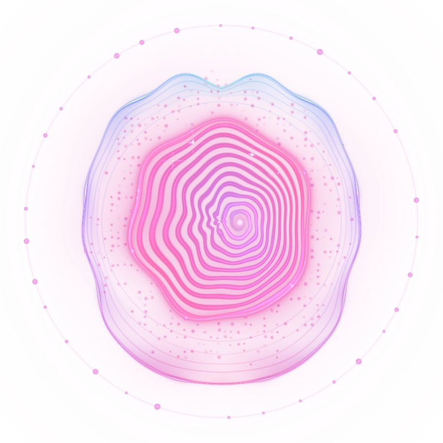
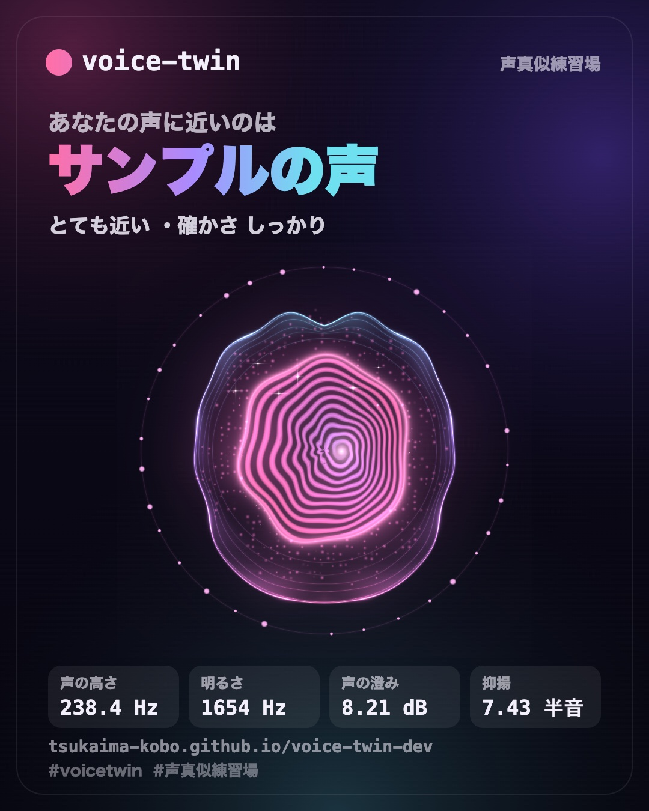
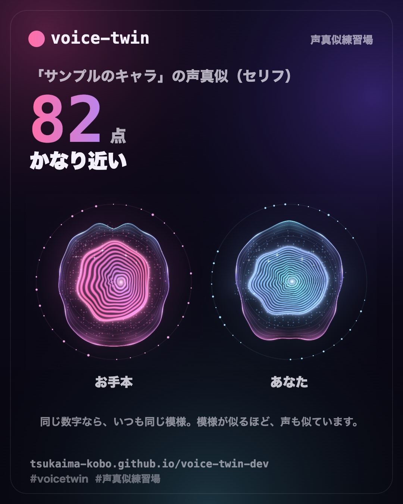

<p align="center"></p>

<h1 align="center">voice-twin</h1>

<p align="center"><b>あなたの声は、誰に近い？</b> — 一言話すだけで声を 45 項目で測り、近い声と、あなただけの声紋を出す Web サイト。<br>
<b>Whose voice is yours closest to?</b> Say a single phrase: we measure your voice in 45 ways, find the closest voices, and draw your own voiceprint.</p>

<p align="center"><a href="https://tsukaima-kobo.github.io/voice-twin-dev/"><b>▶ サイトを開く / Try it</b></a>　·　<a href="https://tsukaima-kobo.github.io/voice-twin-dev/?lang=en">English</a>　·　<a href="https://x.com/tsukaima_kobo">X @tsukaima_kobo</a></p>

<p align="center"> </p>

## できること / Features

- **一言から近い声 / From one phrase**: 声の高さ・響き・音色・声の質から、事前に測った声の中で近い順に 5 つ。もう一言ずつ話すほど絞り込み、続けて長く話すと速さや間まで 45 項目で比べます。
- **声紋 / Voiceprint**: 測った 18 の項目が、それぞれ図のどこかを動かす指紋のような図（WebGL2）。名前を押すと、図のその場所に印と数字。
- **リアルタイム解析 / Live analysis**: 話している間、スペクトログラム・高さの線・数字・測れるようになった項目をその場で計算して見せます。
- **声真似の点数 / Mimic score**: お手本のセリフと同じセリフを真似すると、抑揚・タイミング・声の質で点数と直し方。2 本の線を重ねた図。
- **シェア / Share**: 結果を共有カード（1080×1350）にして X へ。
- **日本語と英語 / Japanese and English**: 同じページで JP / EN を切り替え。

## 約束 / Promises

- 声は端末の中だけで数字にして、すぐに捨てます。どこにも送らず、保存もしません。 / Your voice is turned into numbers on your device and thrown away at once — never sent, never stored.
- サーバーを持たない静的なサイト（GitHub Pages）で、外のサーバーには何も読みに行きません。 / A static site with no server; it loads nothing from elsewhere.
- 声から性別や年齢を判断しません。 / Gender and age are never guessed from a voice.
- 利用者は何も登録しません。 / No sign-up.

## くわしく

一言話すと、声を測って、事前に測った声（数百〜、最終的には数万）の中から近い声を出す Web ページです。もう一言ずつ話すほど絞り込み、最大 45 項目（声の高さ・響き・話す速さなど）で比べます。ふだんの声でも、声真似でも試せます。利用者は何も登録しません。

- 声真似の点数のページ（`mimic.html`）もあります。お手本を選ぶか聞かせてから真似して話すと、近さの点数と直し方を出します。お手本がセリフ 1 つなら、抑揚とタイミングまで比べます（セリフ真似）。
- 探している声が無い時は、だれでもログインなしで声を登録できます（アキネーター方式）。3 つの壁（アルゴリズム・毎日の AI 判定・別々の 3 件以上がそろう）を通った声だけが出ます。[受け付けの設定](docs/registration.md)
- 声（お手本の音も）は利用者の端末の中だけで数字にして、すぐに捨てます。どこにも送らず、保存もしません。
- 声から性別や年齢を判断しません。
- サーバーを持たない静的なサイトです（GitHub Pages）。外のサーバーには何も読みに行きません。

## 開発

```sh
npm install
npm run dev              # 開発用のサーバー
npm test                 # 試験（合成音だけを使う）
npm run typecheck        # 型の確認
npm run build            # dist/ にサイトを作る
npm run build:collector  # 収集の拡張機能を collector/dist に作る
npm run build:voices     # data/voices/ から代表値（data/profiles.json）を作る
npm run eval             # 照合のモデル（data/model.json）を作り、見分ける力を測る（3 つ以上の声がある時）
npm run intake -- --csv 回答.csv  # 声の登録を取り込む（毎日は GitHub Actions が Google スプレッドシートから）
```

## つくり

| 場所 | 中身 |
|---|---|
| `index.html`・`src/ui/voice-page.ts` | 声のページ（お題・マイク・近い声 5 つ・確かさ・もう一言で絞り込む・自分の声の数字） |
| `mimic.html`・`src/ui/mimic-page.ts` | 声真似の点数（お手本・真似・点数と直し方・お題） |
| `src/match/match.ts` | 利用者の数字と、事前に測った声の代表値を比べて近い順に並べる（どの端末でも同じ順位） |
| `about.html` | しくみと約束、データの削除のお願い |
| `src/voice/measure.ts` | 声（PCM）から 45 項目の数字を出す。DOM なし・乱数なし（同じ音なら同じ数字） |
| `src/voice/features.ts` | 項目の名前・単位・説明・画面の目盛り |
| `src/voice/combine.ts` | 長い音を 30 秒ずつ測って中央値にする（音声ファイルのお手本と、代表値づくりで共通） |
| `src/voice/takes.ts` | 何回かに分けて話した声を、数字だけで 1 つにまとめる・確かさ |
| `src/voice/listen.ts`・`wave.ts` | マイクとほかのタブの音、録音中の波形 |
| `src/mimic/mimic.ts` | 真似の点数と直し方（自分で変えやすい 12 項目。幅は暫定） |
| `src/mimic/line.ts` | セリフ真似: 抑揚とタイミングを、時間をそろえて（DTW）比べる |
| `src/ui/orb.ts`・`line-chart.ts` | 声に反応する玉（WebGL）、セリフ真似の図（SVG） |
| `src/site-config.ts` | 公開の住所・作った人のリンク（X など）・GitHub のリポジトリ（空の間はスターの導線を出さない）・X の投稿の住所 |
| `src/ui/share.ts`・`share-card.ts` | 結果のシェア（X に投稿・画像を保存・画像つきで共有）、共有カード（1080×1350）、作った人のリンク、GitHub のスター |
| `tools/github-stars.ts` | スターの数をビルドの時に取ってページに書く（設定がある時だけ） |
| `public/og.jpg`・`vite.config.ts` | SNS で共有された時の絵と、OGP・X のカードの設定 |
| `src/i18n.ts`・`public/lang.js` | 言葉（日本語・英語）。見出しの右の JP / EN で切り替え。ページの文は両方を書き、CSS で片方を見せる。最初の言葉は ?lang=・前に選んだ言葉・ブラウザーの言葉の順 |
| `src/ui/live-analysis.ts` | 録っている間の解析パネル（声の成分の図・高さの線・数字・測れる項目）と、計算中の演出 |
| `src/voice/measure.worker.ts`・`measure-async.ts` | 測定を Web Worker で（計算の間も画面が止まらない） |
| `src/ui/voiceprint.ts`・`voice-shape.ts` | 声紋: 測った数字から描く図（WebGL2。18 項目に連動）と、図の読み方。WebGL2 が無い時の 2D の図 |
| `src/prompts/prompts.ts` | お題 |
| `src/submit/` | 声の登録: 送る内容と壁 ①（`code.ts`）、壁 ③（`consensus.ts`）、Google フォームの住所（`config.ts`） |
| `tools/intake.ts` | 声の登録の取り込み（シートから。壁 ① をもう一度・dots の判定・壁 ③・削除と禁止の言葉のタブ）→ `data/generated/`（ビルドの時だけ） |
| `.github/workflows/site.yml` | 毎日と push の時に、シートを読んでサイトを作り、GitHub Pages へ公開（リポジトリには書き込まない） |
| `collector/` | お手本の声を事前に測る Chrome 拡張機能（運営用。ストアには出さない）。[使い方](docs/collector.md) |
| `tools/` | 代表値づくり（`build-voices.ts`）、照合のモデルと見分ける力の評価（`eval.ts`）、配信の経路で数字がどれだけ動くか（`channel.ts`） |
| `data/` | 声の名前・リンク（`catalog.json`）、30 秒ごとの数字（`voices/`）、代表値（`profiles.json`）、照合のモデル（`model.json`）。登録から出た声は、サイトを作る時だけ Google スプレッドシートから `data/generated/` に作る（リポジトリには入れない） |

## 声のデータの作り方

1. `data/catalog.json` に声を足す（ID・名前・所属や作品名・公式ページのリンク）。
2. 収集の拡張機能で、その声の配信や動画を再生しながら測り、書き出したファイルを `data/voices/` に入れる（[使い方](docs/collector.md)）。
3. `npm run build:voices` で代表値を作り、`npm run eval` で照合のモデルを作り、`npm run build` でサイトを作り直す。

## ライセンス

未定です。

## 本番のリリース

[docs/release.md](docs/release.md)（ライセンス・本番のリポジトリ・スターの導線を出す・GitHub の設定・広め方）。

## ライセンス / License

プログラムは [MIT ライセンス](LICENSE) です。 / The code is released under the [MIT License](LICENSE).

声の名前・公式ページへのリンクなどは、それぞれの声のご本人・権利者の物です（ライセンスの対象は、このリポジトリのプログラムだけ）。 / Names of voices and links to their official pages belong to their owners; the license covers this repository’s code only.
